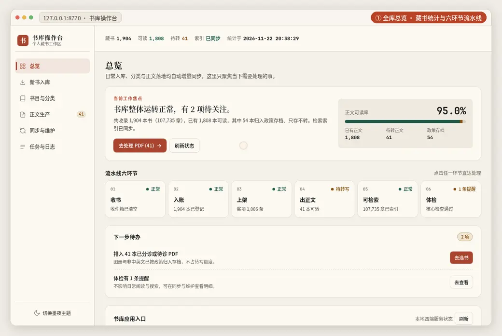
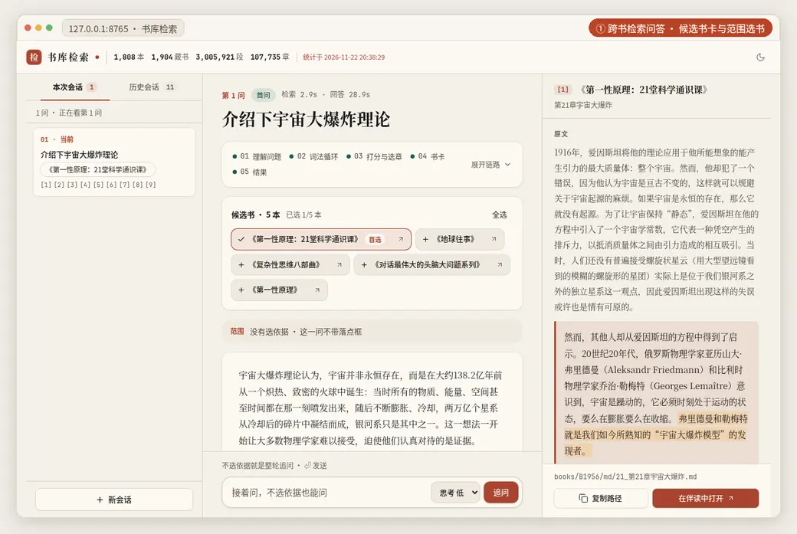

# book-corpus

本地私有电子书库与正文伴读工作台：把多种格式的电子书统一拆成可检索的章节 Markdown，跨书问答带逐字引文直跳原文，阅读时按需展开结构蓝图与随文伴读。

[为什么做](#为什么做) · [功能展示](#功能展示) · [让 Agent 帮你安装](#让-agent-帮你安装) · [完整使用指南](docs/使用指南.md)

> 仓库只包含代码、本地页面与文档，不含任何书的正文。所有书籍、索引、对话与笔记都留在你自己的本地工作区，五个本地服务默认只监听 `127.0.0.1`。

---

## 为什么做

电子书越攒越多，真正想读书或查资料时往往卡在下面几件事：

1. **书囤了一硬盘，格式杂、合集混装，越理越乱**
   EPUB、MOBI、AZW3、纯文本或扫描版 PDF、Word/PPT 文档散在各处，一本多卷合集拆不开、目录对不上，靠手工改名和建文件夹很难长期维持。
2. **记得读过某个观点，就是翻不到出处**
   文件管理器搜不到书内段落，普通关键词检索一换说法就漏检；想跨几十本、上千本书对比不同作者怎么说同一个概念，成本极高。
3. **直接问大模型容易编造，没法核对原书**
   通用对话没有逐字引文和章节锚点，既看不出哪句是原意、哪句是发挥，也跳不回原书上下文继续读。
4. **大部头读不透，切换工具查资料打断心流**
   历史、哲学、文学、社科、科学书各自的脉络抓法不同；外部笔记脱离段落，过几天回头看早已忘了当初针对哪句话发的问。
5. **流水线脚本一断，书架、全文与向量索引就不同步**
   新书入库、改分类、拆章、OCR 或退库之后，若漏跑某一步建库命令，前台看到的书目和实际可搜内容就会脱节。

`book-corpus` 把「收书整理 → 跨书溯源问答 → 原文伴读拆解」串成同一条本地闭环。

---

## 功能展示

### 1. 书库操作台 — 统一收管、分诊与事件驱动同步



- **六模块集中运维**：总览、新书入库、书目与分类、正文生产、同步与维护、任务与日志，支持宣纸日间与墨夜双主题。
- **多格式入库与 PDF 分诊**：收管 `epub / mobi / azw3 / pdf / txt / md / docx / xlsx / pptx`；PDF 自动分诊文本层与扫描件，按需调用云端 OCR 转写。
- **事件驱动自动增量同步**：入库、改分类、拆章、文档转换或退库后，后台自动接力重建元数据、FTS5 全文索引、向量索引与体检缓存。
- **退库与冷宫实物核验**：不留库外副本，移出流程的书统一归入 `books/_冷宫/` 并支持按实物盘点校正退库台账。

---

### 2. 书库检索 — 跨书找一段，带逐字引文与五阶段链路



- **混合检索与书级规划**：BM25（CJK bigram）+ 块向量 RRF 融合（可选交叉编码器精排）；候选离散时自动弹出书卡，点选即可限定回答范围。
- **五阶段链路可展开追溯**：理解问题 → 词法循环 → 打分与选章 → 书卡 → 结果，检索过程不黑盒。
- **流式问答与可中断续答**：SSE 实时输出，随时可暂停并从 checkpoint 接着回答；支持思考档位切换与多轮追问。
- **逐字引文直跳原书段落**：回答中的引用锚点保留原书章节与行号，点击「在伴读中打开」直接落回对应段落并高亮；支持跨书找相关与 MD/DOCX 导出。

---

### 3. 伴读 — 100% 原文直出，书型结构蓝图与随文旁批


- **零延迟正文工作台**：打开章节即出 100% 原文；自动解析转档脚注，支持章内跳转一键回跳正文，以及跨文件注释直达目标章节。
- **按需章节知识地图**：长章可按需生成章节大纲与核心术语树，点击节点直接定位正文；短章自动门控提示，不强行调模型。
- **7 类阅读视角 × 19 种防重叠结构蓝图**：按书目学科自动匹配历史、哲学、文学、科学、社科、实用、图册视角，生成时间线、权力结构、论证链、因果环等交互式图表，支持宽屏画布缩放与节点回跳原文。
- **划词伴读与段落旁批**：框选段落或点 `✦` 即可图解、讲人话举例、翻译、拆解前提或自由追问，满意的结果可钉住为段落旁批并记入操作日志。

---

### 配套入口与命令行

- **书库首页（默认统一入口）**：服务端渲染「找一段 / 翻开书 / 往期日课」与「管理」，平时只需常驻首页，点击具体模块时按需代起对应服务。
- **往期日课**：按日生成并推送一章精选阅读（`book-corpus daily`），可一键在伴读工作台打开原文。
- **命令行工具 `book-corpus`**：`init` / `sample` / `ingest` / `library` / `index` / `embed` / `search` / `query` / `doctor` / `verify` 全套离线与流水线命令，并内置 `book-corpus-qa`、`ebook-to-md` 等 Agent 技能。

---

## 让 Agent 帮你安装

把下面这段提示词直接复制给你的编程 Agent（如 Claude Code、Codex、Cursor、OpenCode、Pi 或 Antigravity），它会先检查本机环境，再向你确认两个选项后自动完成安装与初始化：

```markdown
请帮我安装并初始化 book-corpus 本地电子书库工具：

1. 如果当前目录还不是 book-corpus 仓库，先询问我存放代码的路径并执行 `git clone https://github.com/sk123qaq/book-corpus.git`。
2. 先完整阅读仓库里的 `docs/使用指南.md`（特别是「装」「准备语料」「常用命令」「配置与密钥」几节），按文档里的准确命令操作，不要自己猜参数。
3. 检查系统依赖与工具是否就绪：`python3`（>=3.11）、`git`、`uv`、`rg`（ripgrep）、`calibre`（`ebook-convert`）、`poppler`（`pdfinfo`/`pdftoppm`）、`pi` CLI；如有缺失，给出对应操作系统的一行安装命令或帮我补齐。
4. 在写入本地文件之前，先向我确认两件事：
   - 我的本地电子书工作区准备放在哪个目录（例如 `~/书库`）？
   - 现在是否需要先配置大模型 API Key，还是先装好离线体验样书与检索？
5. 按我的确认执行安装（`uv tool install .` 或 `uv sync --frozen`）、创建工作区（`book-corpus init <工作区目录>`）、装入内置公有领域样书体验（`book-corpus sample --root <工作区目录>`），并运行 `book-corpus doctor --root <工作区目录>` 核对状态。
6. 如有配置密钥，帮我跑通 `book-corpus model check`；最后在工作区启动统一入口首页 `uv run --frozen python apps/home/server.py --root <工作区目录>`，告诉我浏览器打开地址和下一步怎么导入自己的电子书。
```

如果你想自己手动一步步部署、导入书库、配置 OCR / 向量检索或查看全部命令参数，请直接阅读 [完整使用指南](docs/使用指南.md)。

---

## 文档与许可证

- [完整使用指南](docs/使用指南.md)：系统依赖、安装、目录布局、CLI、模型与 OCR 配置、改完自检清单
- [贡献指南](CONTRIBUTING.md)：本地测试、代码规范与提交流程
- [术语表](GLOSSARY.md)：五个本地应用、伴读与同步链路现行术语
- [文档索引](docs/INDEX.md) 与 [代码生成事实表](docs/reference/facts.md)：全仓设计文档、ADR 与自动生成的端口/脚本清单
- 许可证：MIT，见 [LICENSE](LICENSE)
