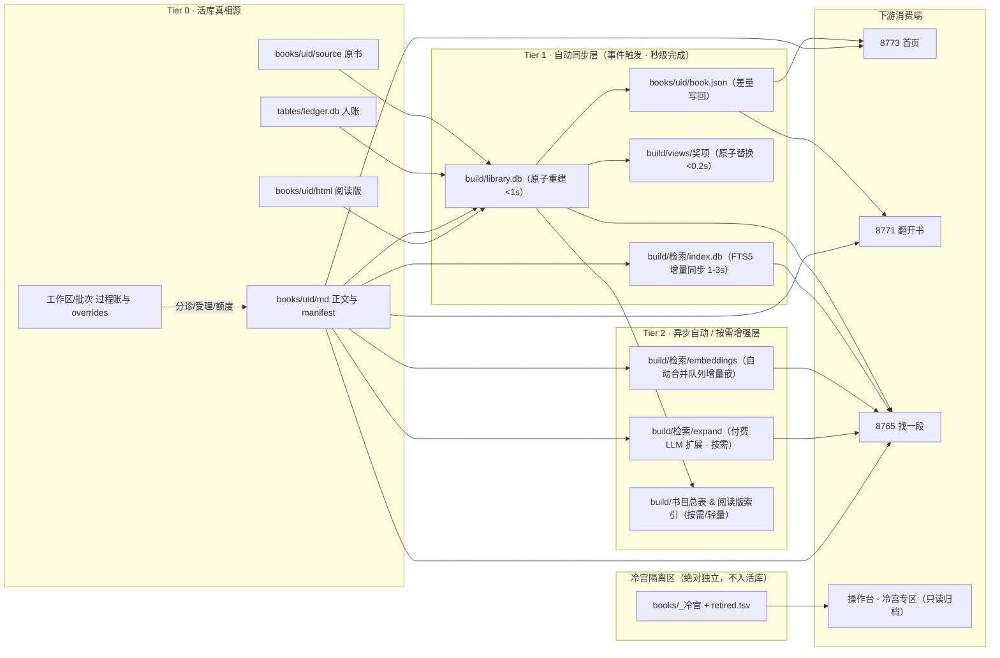
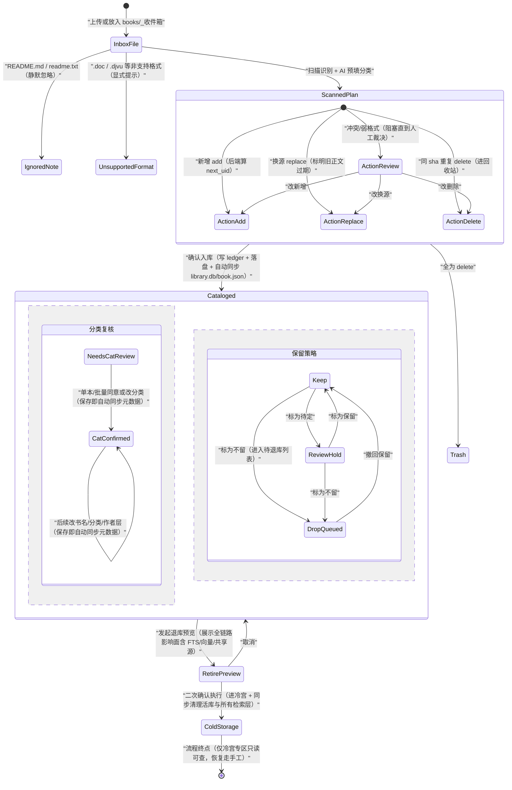
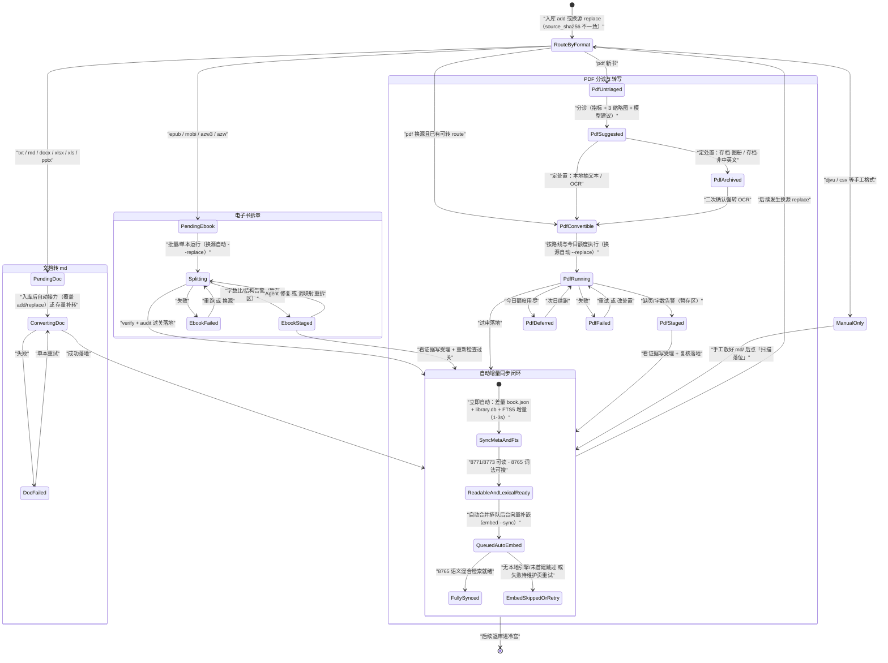
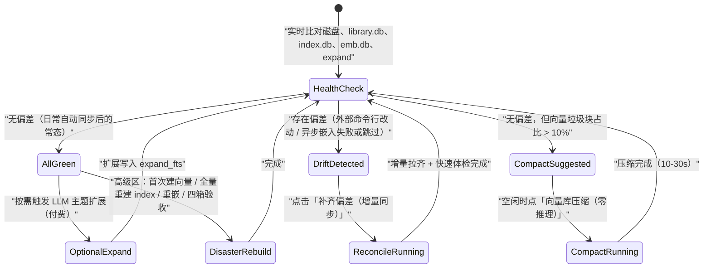

# 书库操作台重新规划方案（V2 · 事件驱动全自动同步版）

状态：implemented · 2026-11-19
验收：`uv run --frozen pytest tests/test_incremental_sync.py tests/test_ops_fixes.py && uv run --frozen python tests/acceptance/ops/check_ops.py`

> **核心范式转变**：从「生产完去维护页点一键收尾（全量重建）」升级为「**事件驱动全自动增量同步 + 维护页专司兜底、补偿、低频压缩与灾备**」。正常在操作台完成入库、改分类、拆章、OCR、退库后，系统自动保持全库一致，用户**不需要**再手动跑「一键收尾」。早期 V1 方案见 [统一操作台方案（2026-10-24）](统一操作台-方案-2026-10-24.md)。

---

## 一、回答两个核心架构问题

### 1. 分章 / PDF OCR / 文档转换后，能不能自动同步到所有文档和数据库？

**完全可以，而且应当成为默认行为。** 此前做不到，唯一瓶颈是 [build_para_index.py](../../src/bookcorpus/scripts/build_para_index.py) 只有全量 `--rebuild`（40–70 分钟），以及 [embed_corpus.py](../../src/bookcorpus/scripts/embed_corpus.py) 未接入调度器。把增量能力补齐后，每一次业务事件都可以精确触发对应的自动同步链路：

| 业务事件（触发源） | 自动同步动作（随事件立即执行，秒级） | 后台自动接力（异步合并队列，不阻塞操作） | 完成后下游立刻可见 |
|---|---|---|---|
| **新书入库（`import.apply`）** | 差量写新书 `book.json` → 原子重建 `library.db`（<1s）→ 刷新 `书目总表` | 若含文档类书（`add`/`replace`）→ 自动接力 `docs.run` | 新书立刻进入书目库与待转队列 |
| **人账编辑 / 同意分类（`ledger` 保存）** | 差量写变更书 `book.json` → 原子重建 `library.db`（<1s）→ 刷新奖项软链（若涉奖项/书名） | 无需动 `index.db` / `emb.db`（正文未变，0 检索成本） | `8771 翻开书` 策略、`8773 首页`、`8765` 书名立刻更新 |
| **正文落地（`split.run` / `docs.run` / `pdf.run` / 手工扫描落位）** | 差量写 `book.json` → 原子重建 `library.db`（<1s）→ **增量同步 `index.db` FTS5（1–3 秒）** | **自动排队 `sync.embed`（合并去重）**，仅对本次新增/变更书增量算向量（约 10–15s/本；无本地引擎或向量库未首次构建时平滑跳过不报错） | 落地 3 秒内：`8771/8773` 可读 + `8765` 全文可搜；后台嵌完：`8765` 语义混合可搜 |
| **换源重转（`replace` 后重跑）** | 同上（自动带 `--replace` 归档旧 `md/`）；FTS5 自动先删该书旧段再插新段 | `sync.embed` 自动把该书旧向量块标 `active=0` 并重新嵌入新正文 | 旧正文彻底替换，零重复脏命中 |
| **退库进冷宫（`retire.apply`）** | 移原书至 `books/_冷宫/` → 删 `md/html/book.json` 与人账行 → 删 `index.db` 该书 `para` + `expand` → 失活 `emb.db` 该书块（`active=0`）→ 重建 `library.db` 与 `views` | 无残留，无需后续收尾 | 该书从全库、检索与所有应用彻底消失，仅留冷宫只读归档 |

> [!TIP]
> **为什么异步 `sync.embed` 要做成「合并去重队列」？**
> 如果你在 2 分钟内连续拆完了 5 本书，第 1 本落地时排队一个 `sync.embed`；第 2~5 本落地时发现队列里已有 `sync.embed` 在等，就直接合并进去，不会连排 5 个任务反复冷启动 `llama-server`。而 `embed_corpus.py --sync` 按全库 `sig` 差集扫描，一次启动把这 5 本一口气嵌完。
>
> **未初始化向量库防线**：若 `emb.db` 尚未完成首次构建（`chunks=0`），日常自动接力与 `reconcile` 默认跳过自动建库且不计入待同步漂移，避免误触发 6–7 小时的全库首建；需由用户在维护页通过显式 `embed_init` 入口启动首次构建。

---

### 2. 自动同步做好之后，「手动维护 / 增量同步」还有什么场景必须用户来处理？

正常通过操作台流转时，维护页应当**始终全绿，零手动操作**。手动按钮只服务于 **5 类自动化无法替用户做决定或无法感知的场景**：

1. **绕过操作台的外部/命令行改动（偏差兜底 Reconcile）**
   - 例如：你在终端手工转好了 `djvu`/`csv` 并把 `.md` 放进了 `books/<uid>/md/`；或手工修正了某章 `.md` 里的错字；或直接用 SQL/CLI 改了 `tables/ledger.db`。
   - 操作台未收到写事件，因此需要「**扫描并补齐偏差**」按钮：对比磁盘真实状态与三大库，自动增量拉齐所有差集。
2. **异步环节失败或离线后的补偿重试（Catch-up）**
   - 例如：之前跑 OCR/拆章时本地 `llama-server` 没开、显存被占导致自动向量嵌入被跳过/失败，事后补跑一次增量向量同步。
3. **涉及外部 API 费用的可选增强（Opt-in）**
   - `LLM 章级主题扩展（build_expand.py）` 会消耗外部模型 token 费用，不适合静默自动扣费；在维护页展示未覆盖书数与预估费用，由用户显式勾选触发（也提供全局开关供愿意全自动的用户开启）。
4. **低频物理整理与灾备重建（Compaction & Rebuild）**
   - **向量库零推理压缩（`embed --compact`，10–30 秒）**：长期退库或换源重转后，`vectors.f16` 中 `active=0` 垃圾块占比超阈值（如 >10%）时亮提示，用户挑空闲点一次纯磁盘拷贝重编号压缩（**不重新跑 GPU 推理**）。
   - **词法库全量重建（`index --rebuild`，40–70 分钟）**：仅当 `index.db` 损坏、分词清洗算法升级或碎片严重时使用。
   - **向量库首次构建 / 全量重嵌（6–7 小时）**：仅当首次启用向量库（`embed_init`）或更换 Embedding 模型与向量维度时使用。
5. **深度不变量校验、按需导出与日志清理**
   - `audit_state --deep` 深度全库审计、`verify_phase` 四箱结构验收（代码升级/大迁库后运行）。
   - 按需导出 `书目总表.xlsx/.csv`、`阅读版索引.html`，以及清理 90 天前的旧运行日志与缩略图。

---

## 二、数据真相、冷宫隔离与三层依赖 DAG

> [!CAUTION]
> **冷宫绝对隔离红线**：
> - 退库执行后，原书移入 `books/_冷宫/`，仅登记 `retired.tsv` 与 `books/_冷宫/README.md`。
> - 冷宫书**绝不进入** `books/<uid>/`、`md/`、`book.json`、`ledger.db`、`library.db`、`index.db`、`emb.db`、`views/` 或 `8765/8771/8773`。
> - 操作台仅在专门的「冷宫」视图内提供只读查阅，**不提供一键恢复按钮**，恢复一律走手工流程。

---

## 三、全链路正交 Statechart 校验

用 4 个正交状态机验证全流程无死状态、无断链、无人工漏同步：

### 3.1 入库、编目与冷宫退库状态机

### 3.2 正文生产与自动同步联动状态机

### 3.3 维护兜底、补偿与低频运维状态机

### 3.4 任务调度与收口状态机

- 所有写任务走进程级串行锁，但**读操作（状态、日志、分诊探针、查看问题、冷宫查询）完全并发无阻塞**。
- `awaiting_review` 铁律：**只由明确的人工决策触发，且必由对应的下游完成事件自动收口**（`import.apply` → 收口 `import.scan`；`pdf.confirm/settle` → 收口 `pdf.triage`；`split/pdf recheck` 过关 → 收口 `split.run/pdf.run`）。
- 异步自动任务（`sync.embed`）具备**队列合并防抖**：已有 `queued` 的 `sync.embed` 时，新落地书籍不再重复创建第二个排队任务，合并在同一次 `--sync` 里完成。

---

## 四、底层引擎的 4 项核心升级清单

1. **[build_para_index.py](../../src/bookcorpus/scripts/build_para_index.py) — 增量 FTS5 同步引擎**
   - 在 `index.db` 中新增 `indexed_book(book TEXT PRIMARY KEY, sig TEXT NOT NULL, chapters INT, paras INT, chars INT, indexed_at TEXT)`。
   - **老库无痛迁移**：首次运行 `--sync` 时检测若无 `indexed_book` 表，直接把现有 `para` 按书聚合核对磁盘章数，对一致的存量书直接写入当前 `sig` 基线（<2 秒），无需重跑 60 分钟全量。
   - 新增 `--sync`（全库差集）、`--sync --books <uids>`（定向增量，供拆章/OCR/文档落地直接调）、`--delete <uids>`（供退库直接调）、`--dry-run`（供状态探测秒级输出待增/改/删清单）。
   - 使用 SQLite FTS5 external-content 标准增量命令（与 [build_expand.py](../../src/bookcorpus/scripts/build_expand.py#L620-L630) 同口径）：先 `'delete'` 旧 `rowid`，删 `para`，再插新 `para` 与 `para_fts`，同步刷新 `meta`。
2. **[embed_corpus.py](../../src/bookcorpus/scripts/embed_corpus.py) — 增量孤儿清理与零推理压缩**
   - 新增 `--prune` 与 `--sync`：先将已不在 `library.db` 或已无 `md/` 的书在 `emb.db` 中置 `chunk.active=0`、`book.status='removed'`（秒级 SQL，无新增书时根本不启动 `llama-server`），再仅对新增/改源书增量计算向量。
   - 新增 `deactivate_books(uids)` 供退库直接调用。
   - 新增 `--compact`：流式复制全部 `active=1` 块与对应 `vectors.f16` 行到临时文件并重编 `chunk.id`，原子替换（纯磁盘整理，**零 GPU 推理**，~10–30 秒）。
3. **[build_library.py](../../src/bookcorpus/scripts/build_library.py) — 差量写回 `book.json`**
   - `emit_book_json()` 写盘前对比目标文件已有内容，字节完全一致则跳过，避免每次同步触碰无关文件的 `mtime`；建库本身保持 `.building → os.replace` 秒级原子重建确保全局约束。
4. **[retire_book.py](../../src/bookcorpus/scripts/retire_book.py) & [ops_status.py](../../src/bookcorpus/scripts/ops_status.py) — 全链路清理与透明偏差探测**
   - `retire_book.py` 预览补上 `embed_chunks`；执行时同步清除 `para`/`para_fts`/`expand`/`expand_fts` 并失活 `emb.db` 块，刷新 `library.db` 与 `views`。
   - `ops_status.py` 输出完整 `sync_delta`（元数据、FTS5 增改删清单、向量待嵌/孤儿/垃圾块占比、向量库初始化状态、LLM 扩展未覆盖数、本地向量引擎可用性），支撑「维护页」做到全透明。

---

## 五、重构后的「书库操作台」页面信息架构

从原有 8 个零散页重构为 **6 个职责清晰的业务域**，消除割裂与重复跳转：

| 导航模块 | 职责定位 | 核心页面与功能 |
|---|---|---|
| **1. 总览** | 态势仪表盘 & 流水线入口 | • **5 阶段漏斗进度条**：`收件箱` → `分类待复核` → `正文生产（电子书/文档/PDF/手工）` → `检索同步（自动同步状态/偏差数）` → `可读可搜`。 • **下一步待办**：按阻塞优先级呈现当前唯一需人介入的事（无事时直接显示「全部就绪」）。 • **多端服务状态栏**：直接集成 `8773 首页`、`8765 找一段`、`8771 翻开书`、`8772 日课` 状态与一键拉起跳转（复用 [app_links.py](../../src/bookcorpus/app_links.py)）。 |
| **2. 新书入库** | 收件箱 → 扫描 → 审核 → 落位 | • 拖拽/多选上传；静默过滤 `README.*`；单独折叠提示非支持格式文件。 • 扫描清单审核台：区分 `新增 / 换源 / 删除 / 待核`，后端准确提供 `next_uid`，换源标出“旧正文将标为过期待重转”，支持一键采用 AI 建议分类。 • 入库后直接给出本次落地摘要与下一步快捷跳转（文档自动转 md 进度、电子书直达拆章、PDF 直达分诊）。 |
| **3. 书目与分类** | 人账编辑、分类复核、退库流程、冷宫专区 | 用顶部 4 个清晰子标签收口全部治理动作： • **待复核分类**：集中处理 AI 预填带「待复核」的书，单本/批量同意或改分类，**提交即自动同步**。 • **全库书目台账**：按分类、格式、正文状态、同步状态、保留策略筛选；行内编辑保存**自动同步 `library.db` + 差量 `book.json` + 奖项软链**；移除裸删账行，只提供「标为不留」。 • **待退库与删书**：集中显示 `retention=drop` 的书 + 搜书退库；完整预览（含 `para`/`expand`/`embed` 块数、共享源硬链、系列文档）+ 二次确认，执行即彻底清理活库与检索层。 • **冷宫（只读专区）**：严格与活库隔离，仅读 `books/_冷宫/` 与 `retired.tsv` 展示历史退库清单、原因、时间与原书位置，明示恢复靠手工。 |
| **4. 正文生产** | 全格式统一出正文（落地即自动同步检索） | 顶部 4 个子标签覆盖全部格式，正文一过审即自动触发秒级元数据 + FTS5 增量同步，并后台排队增量向量嵌入： • **电子书**：待拆/换源标旧清单 + 批次监控 + 异常书复核抽屉（审计比/未收录页/结构告警 → 受理并重检 / Agent 修复 / 重拆）。 • **文档**：入库自动转换进度 + 存量补转 + 失败重试。 • **PDF**：批量分诊 + 多维筛选清单 + 弹窗看指标与 3 张缩略图定处置 + 今日 OCR 额度进度条 + 转写与暂存受理。 • **手工格式（DJVU/CSV）**：展示目标目录 `books/<uid>/md/`，人工放好后点「扫描落位」即自动入库并触发增量检索同步。 |
| **5. 同步与维护** | 异常兜底、付费增强与低频运维（平时无需操作） | • **自动化状态与偏差面板**：正常时全绿显示「已自动同步」；展示自动向量同步开关状态与未初始化首次构建提示。只有检测到外部改动或异步失败时，才高亮列出精确差集（可展开看具体 `uid` 与书名）并亮起「**补齐偏差（增量同步）**」。 • **按需增强与导出**：`LLM 章级主题扩展`（显示待扩书数与预估费用，按需勾选执行）；`书目总表 Excel/CSV`、`分类预填表`（仅存在时可点）、`阅读版 HTML 索引` 导出。 • **折叠高级区（低频运维与灾备）**：① `首次构建全库向量（embed_init）` 与 `向量库零推理压缩（--compact，垃圾块 >10% 时提示）`；② `词法库全量重建（--rebuild，40–70 分钟）`；③ `向量库全量重嵌（6–7 小时）`；④ `深度全库体检 + 四箱验收`；⑤ `清理旧任务日志与缩略图`。 |
| **6. 任务与日志** | 全链路可观测与故障恢复 | • 实时查看进行中（含后台自动接力的 `docs.run` / `sync.embed`）、待处理（`awaiting_review` 带深链自动收口）、已完成与失败任务。 • 步骤级进度、实时日志、取消/重跑与重启孤儿接管。 |

---

## 六、分阶段实施路线

1. **阶段 1 · 底层增量引擎与隔离闭环**
   - `build_para_index.py` 实现 `indexed_book` 无痛迁移、`--sync`、`--delete`、`--dry-run` + 单测。
   - `embed_corpus.py` 实现 `--prune`、`--sync`、`--compact`、`deactivate_books` + 单测。
   - `build_library.py` 差量回写 `book.json`；`retire_book.py` 补全 FTS5 与向量单书清理 + 单测。
2. **阶段 2 · 事件驱动自动同步与后端 API 重构**
   - `ops_status.py` 输出完整 `sync_delta` 与冷宫只读统计（不混入活库）。
   - `apps/ops/server.py` 落地：正文落地自动接力 FTS5 增量 + 合并去重队列异步 `sync.embed`（含未初始化向量库防线与 `/api/settings` 开关）；人账保存即自动同步；新增 `/api/sync/reconcile`、`/api/sync/expand`、`/api/maintain/advanced`、`/api/manual/rescan`、`/api/cold`（冷宫只读）、`/api/services`；历史实现契约见 [docs/briefs/OPS-CONTRACT-2026-10-24.md](../briefs/OPS-CONTRACT-2026-10-24.md)，现行接口表见 [apps/ops/README.md](../../apps/ops/README.md)。
3. **阶段 3 · 操作台前端重构（6 大模块 UI）**
   - 按新信息架构重构 `apps/ops/web/`（原生 JS + CSS，零外部依赖），完成「总览 / 新书入库 / 书目与分类（含冷宫只读专区）/ 正文生产 / 同步与维护 / 任务与日志」。
4. **阶段 4 · 端到端全量验收与实库验证**
   - 补全回归单测（`tests/test_incremental_sync.py`、`tests/test_ops_fixes.py`）、`check_ops.py`、`test_status_state.py`、一次性工作区端到端实测（验证拆章/文档/PDF 落地自动同步 FTS5 + 向量合并队列、人账保存自动同步、外部改动补齐偏差、冷宫严格隔离、向量零推理压缩），并跑过 `pre-commit` 与 `docs check`。
